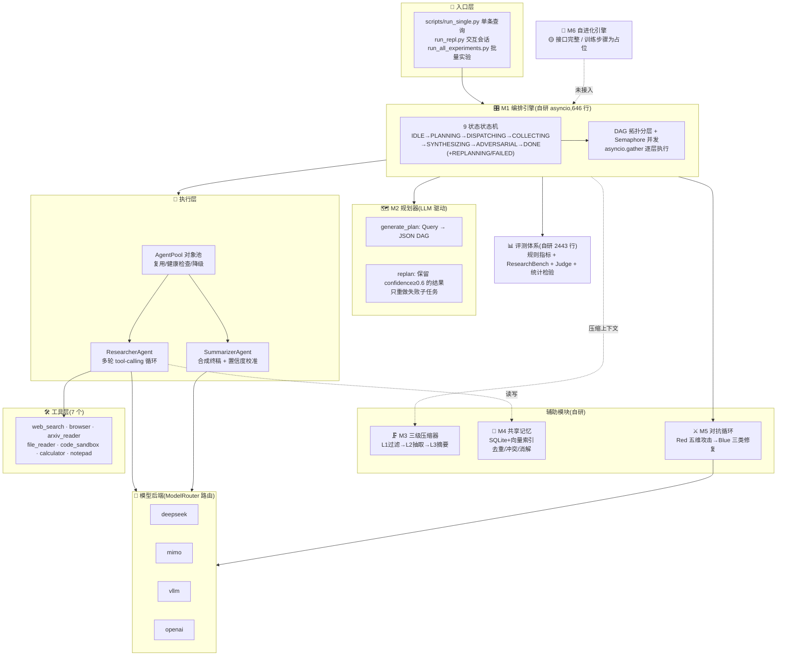
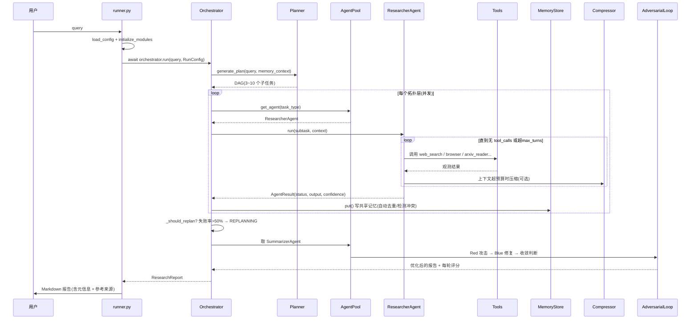

# 01 · 项目全貌 & 学习路线【带读讲义 · 第 1 讲】

> 本讲义属于"带读模式"系列:每讲 = 大白话 → 带读代码 → 对照样例 → 跟读复述。本讲是**全系列入口**,后续 12 讲都从这张"地图"出发。
> 本讲目标:**说得出六个模块各自治什么病、画得出数据流、背得出七个核心数字、拿到后续讲次的路线图**。
> 使用方式:VS Code 打开项目文件夹 → 本 md 按 `Ctrl+Shift+V` 预览 → 点击蓝色链接直接跳代码。行号已与当前代码核对。
> **本讲有一条贯穿全篇的纪律**:这个项目的 README 和代码有多处对不上。凡是冲突处,本讲**一律以代码为准,并把差异写出来**——因为面试官问的是代码,不是 README。

## 📖 阅读导航:哪部分必须读,哪部分可以跳(先看这个!)

| 优先级 | 内容 | 读到什么程度 |
|---|---|---|
| 🔴 **必读**(约 30 分钟) | 第 1 节(一句话定位)、第 3 节(六模块流水线)、第 4~5 节(架构图 + 数据流)、第 6 节(关键数字总表)、第 7 节(成熟度自评)、第 8~10 节(学习顺序 + 代码优先级 + 讲次清单) | 要能画图复述、七个数字背得出 |
| 🟡 **选读** | 第 2 节(为什么自研编排)、第三部分名词小词典(当字典用) | 能对着讲即可 |
| ⚪ **可跳过** | 附录里的"README 与代码差异速查表" | 面试前回来扫一遍即可 |

**这一讲怎么用**:它是"地图",不是"教材"。第一遍求快(30 分钟读完,不必记住每个细节),目的是建立坐标系——后面每一讲讲到的模块,你都知道它在全景图的哪个位置、上下接什么。学完最后一讲再回来读一遍,感受会完全不同。

---

# 第一部分 · 项目全局总览

## 1. 一句话定位、目标、现实业务痛点

**一句话定位:** 从零搭一套**面向复杂研究问题的多智能体系统**——把一个模糊的研究 Query,通过「规划 → 并发检索 → 压缩 → 记忆 → 对抗降噪 → 合成」全链路,产出一份**带引用、可验证的 Markdown 深度研究报告**,并配套一套**可复现、可量化**的评测体系。

拆开看四个关键词:

- **复杂 Query**:不是"北京天气怎么样",而是"对比分析 2024–2025 年大模型 Agent 技术与后端系统开发两个方向的论文趋势、落地案例与市场规模"。这类问题**一次检索答不出来**,必须拆。
- **多智能体**:不是一个 Agent 从头干到尾,而是 Planner 拆成 DAG → 多个 Researcher 并发跑 → Summarizer 合成。**分工是效率来源,也是复杂度的来源**。
- **全链路自动化**:从用户敲下 Query 到落盘 `.md` 报告,中间不需要人干预。
- **可复现评测**:这是"工程"和"Demo"的分水岭。项目自建了 35 题评测集,并实现了规则指标 + LLM 评审 + 统计显著性三层。

**现实业务痛点(简历"三个问题"的实指):**

| 痛点 | 通俗描述 | 项目里的对应模块 |
|---|---|---|
| **信息爆炸与上下文遗忘** | 检索回 20 篇网页,加起来几万字,全塞进 prompt 会爆;粗暴截断又丢掉关键数字 | 🗜️ M3 上下文压缩器 |
| **幻觉与事实漂移** | 多轮推理里,模型开始"编"没验证过的数字,而且越写越信 | ⚔️ M5 Red-Blue 对抗降噪 |
| **缺乏系统性评估** | 大部分 Agent 项目只有"跑几个例子看着还行",没有可复现的分数 | 📊 整套 `evaluation/` |

再加上一条**工程痛点**,它撑起了项目一半的代码量:

| 工程痛点 | 通俗描述 | 对应模块 |
|---|---|---|
| **长链路不可控** | 一个子任务卡住,整条链路是等它、跳它、还是重来?谁来管并发上限?谁管全局超时? | 🎛️ M1 编排器 + 🗺️ M2 规划器 |
| **跨 Agent 重复劳动与自相矛盾** | 三个 Agent 各查了一遍同一件事,结论还不一样 | 🧠 M4 共享记忆 |

一句话:**这个项目要解决的不是"模型会不会答题",而是"一条十几步的自动化研究流水线,怎么跑得稳、跑得省、跑出来的东西敢不敢信"。**

## 2. 为什么不用 LangGraph / AutoGen(自研编排的动机)

这是面试第一个会问的问题,先讲清楚。

**先承认事实**:项目**确实没有用** LangGraph / AutoGen / CrewAI 这类编排框架。依赖清单里(`requirements.txt`)与编排有关的只有 `openai`、`aiohttp`、`asyncio`(标准库),没有任何 Agent 框架。**待确认**:仓库里没有文档写明"为什么当初选自研"。以下是**分析**(设计动机类判断,源码不会写"为什么"):

| 维度 | 用现成框架 | 自研(本项目选择) |
|---|---|---|
| **调度控制** | 框架给什么用什么(通常是固定图或 ReAct 循环) | 自己实现 `asyncio.Semaphore` + 拓扑分层,并发度、超时、重试全在自己手里 |
| **降级策略** | 框架的重试语义是"重试",不是"跳过→局部重规划→全局强制合成" | 三级降级按业务语义自己写(`_should_replan` 的阈值是项目自己的判断) |
| **可审计** | 中间状态在框架的对象里,要打日志得改框架 | 每个状态转换 `print` 出来,子任务成功/失败计数自己算 |
| **依赖面** | 引入一个迭代很快的重依赖,升级会碎 | 依赖只有 `openai` + `asyncio`,轻 |
| **代价(必须主动说)** | 开箱即用,社区验证过 | **所有边界情况都要自己处理**(如 `_run_one` 里的超时/异常兜底),而且**没有框架提供的 checkpoint / 断点续跑**——这是本项目的真实短板 |

**面试口径(30 秒版):** "选自研编排是为了完全掌控调度语义——三级降级、动态重规划和状态机审计都需要在框架外面改,与其给框架打补丁,不如用 `asyncio` 自己写一层薄编排。代价是边界情况全得自己兜,也没有现成的断点续跑,这部分我认。"

## 3. 六大模块流水线:每个模块治什么病

代码规模(实测,`wc -l` 统计):

| 模块 | 代码位置 | 行数 | 一句话职责 |
|---|---|---|---|
| 🎛️ **M1 Orchestrator** | [src/orchestrator/](../src/orchestrator/orchestrator.py) | 646(+池 157 + schema 153) | 9 状态状态机 + DAG 拓扑并发调度 |
| 🗺️ **M2 Planner** | [src/planner/](../src/planner/planner.py) | 375(+DAG 159 + 预算 103) | LLM 驱动的 Query 拆解与增量重规划 |
| 🗜️ **M3 Compressor** | [src/compressor/](../src/compressor/compressor.py) | 377(+抽取 256 + 滑窗 178 + 摘要 175) | 三级渐进式上下文压缩 |
| 🧠 **M4 Memory Store** | [src/memory/](../src/memory/memory_store.py) | 593(+长期 500 + 短期 143 + 向量 148) | 跨 Agent 共享记忆:去重、冲突检测与消解 |
| ⚔️ **M5 Adversarial** | [src/adversarial/](../src/adversarial/red_agent.py) | 481 + 501 + 200 + 286 | Red 攻击 → Blue 修复 → 评分收敛 |
| 🧬 **M6 Evolution** | [src/evolution/](../src/evolution/engine.py) | 367 + 292 + 394 + 124 + 283 + 316 | 自进化引擎(**接口完整,训练未接通**,见第 7 节) |

外加两块不编号但同样重要的:

| 模块 | 代码位置 | 职责 |
|---|---|---|
| 🔌 **模型路由层** | [src/models/](../src/models/model_router.py) | 4 类后端热切换 + 模块级采样参数 |
| 🛠️ **工具层** | [src/tools/\_\_init\_\_.py](../src/tools/__init__.py)(另有 7 个工具实现文件) | 7 个工具:搜索 / 网页 / 论文 / 文件 / 沙箱 / 计算器 / 笔记 |
| 📊 **评测体系** | [evaluation/](../evaluation/metrics.py) | 2443 行:规则指标 + 基准集 + Judge + 统计检验 |

**每个模块"治什么病"对照:**

| 模块 | 不这么做会怎样(讲动机) |
|---|---|
| M1 编排器 | 20 个子任务串行跑 = 10 分钟变 2 分钟?不,是**卡死没人管**。并发度没上限会打爆 API;没有状态机就说不清"现在到底卡在哪一步" |
| M2 规划器 | 拆得太粗 = 一个问题搜不到底;拆得太死 = 有个子任务失败了整条链报废。所以需要**执行中可重规划** |
| M3 压缩器 | 全塞进上下文 = 超限报错 / 成本爆炸;硬截断 = 把关键数字腰斩。所以需要**按相关性分级压缩** |
| M4 记忆 | 三个 Agent 各查一遍同一件事,既费钱又可能出现互相矛盾的结论。所以需要**写前查重 + 冲突登记** |
| M5 对抗 | 报告写完就交,里面的幻觉没人发现。所以需要**一个专职"找茬"的 Agent 和一个专职"修补"的 Agent** |
| M6 进化 | 系统的 Prompt 是人工写的,不会随经验变好。**本项目的这一层只搭了架子**(见第 7 节) |

## 4. 整体架构框图

图例:🟢 = **仓库里有完整实现**;🟡 = **接口完整但关键环节是占位**(本项目的 M6 属于此类);🔵 = **外部依赖**(API / 模型,项目只调用不改)。



**背这三句分界线(面试灵魂问题"哪些是你做的"):**

- 🟢 **自研**:编排状态机与 DAG 调度、规划与重规划、三级压缩、共享记忆与冲突消解、对抗循环与评分引擎、模型路由、7 个工具封装、整套评测体系。**这是项目的绝大部分代码。**
- 🟡 **有架子没通电**:M6 自进化引擎——六个文件、上千行,类结构和流程都写全了,但**真正的训练那一步是注释掉的伪代码**(下一节展开)。
- 🔵 **外部**:DeepSeek / MiMo / vLLM / OpenAI 提供的模型能力,以及搜索引擎、OpenAlex 等公开 API。项目只调用。

## 5. 完整全局数据流(一条 Query 从头到尾)

以 `python scripts/run_single.py --query "..."` 为例,真实调用链(逐跳都能在代码里点到):



**关键跳转的代码位置(点开看):**

1. 入口组装模块 — [runner.py:127-269 initialize_modules()](../src/core/runner.py#L127-L269)
2. 状态机主循环(含全局超时强制合成) — [orchestrator.py:101-188 run()](../src/orchestrator/orchestrator.py#L101-L188)
3. 规划 — [planner.py:127-156 generate_plan()](../src/planner/planner.py#L127-L156)
4. 拓扑分层并发执行 — [orchestrator.py:226-301 _do_dispatching()](../src/orchestrator/orchestrator.py#L226-L301)
5. 共享记忆写入 — [memory_store.py:211-262 put()](../src/memory/memory_store.py#L211-L262)
6. 对抗优化 — [loop.py:65-159 run()](../src/adversarial/loop.py#L65-L159)
7. 报告落盘 — [runner.py:340-381 _format_report()](../src/core/runner.py#L340-L381)

**一个容易讲错的细节**:`_do_synthesizing()` 里并不是"从池里拿一个 Summarizer",而是**先拿一个 Agent,再检查类型,不对就现场换掉**(见 [orchestrator.py:386-393](../src/orchestrator/orchestrator.py#L386-L393))。原因是 `AgentPool._create_agent()` 对 `analyze` 类型返回的是 `ResearcherAgent`([agent_pool.py:139-140](../src/orchestrator/agent_pool.py#L139-L140))。这是个**代码里的既成事实**,面试被问到"合成用的什么 Agent"时,如实说"合成走的是单独替换出的 SummarizerAgent,因为对象池的类型路由只覆盖了 search/analyze/verify"。

## 6. 关键数字总表(标证据档位)

> **证据档位说明**(本系列统一):**实测** = 跑出来的东西;**阶段结果** = 中间产物计数;**技术验证** = 能跑通但没测规模;**待确认** = 仓库里查不到证据。

| 数字 | 值 | 档位 | 出处 |
|---|---|---|---|
| 源码规模 `src/` | 11,703 行 | 实测(`wc -l`) | `find src -name "*.py" \| xargs wc -l` |
| 评测体系 `evaluation/` | 2,443 行 | 实测 | 同上 |
| 编排状态数 | **9 个** | 阶段结果 | [schemas.py:29-45](../src/orchestrator/schemas.py#L29-L45) |
| 子任务类型 | **3 种**(search / analyze / verify) | 阶段结果 | [schemas.py:48-52](../src/orchestrator/schemas.py#L48-L52) |
| 工具数量 | **7 个** | 阶段结果 | [src/tools/__init__.py:12-29](../src/tools/__init__.py#L12-L29) |
| 评测题目 | **35 题** | 阶段结果 | [research_bench.py:26-417](../evaluation/benchmarks/research_bench.py#L26-L417) |
| 覆盖领域 | **11 个**(科技8/医疗6/金融6/教育2/法律2/能源2/消费2/汽车2/游戏2/传媒1/交叉2) | 阶段结果 | 同上,`grep -o '"domain": "[^"]*"' \| sort \| uniq -c` |
| 批量实验计划运行次数 | **约 165 次** | 阶段结果(**计划值,不是已跑值**) | [run_all_experiments.py:376-390](../scripts/run_all_experiments.py#L376-L390) |
| 并发上限 / 全局超时 | **5 / 600 秒** | 阶段结果 | [default.yaml:109-120](../configs/default.yaml#L109-L120) |
| 去重阈值 / 冲突阈值 | **0.92 / 0.65** | 阶段结果 | [default.yaml:148-161](../configs/default.yaml#L148-L161) |
| 记忆表容量上限 | **10,000 条** | 阶段结果 | 同上 |
| 五维评分权重 | **0.30 / 0.25 / 0.20 / 0.15 / 0.10** | 阶段结果 | [verdict.py:188-194](../src/adversarial/verdict.py#L188-L194) |
| Bootstrap 重采样次数 | **10,000 次** | 阶段结果 | [stats.py:20-24](../evaluation/metrics/stats.py#L20-L24) |
| 真实跑通的报告 | **5 份**(19 万字符) | **实测** | [outputs/](../outputs/reports1/report_20260509_130149_2024年至2025年大模型Agent技.md) |
| 评测结果数据(accuracy 等) | **仓库中没有** | **待确认** | 无 `experiments/` 目录,无结果 JSON |
| 对抗"三层 JSON 解析把成功率 85%→95%" | **仓库中查无出处** | **待确认** | 全仓库 grep `85%` / `95%` 只命中无关文本 |

**第 7 行和第 14~16 行是面试的重点。** 前者说明"165 次"是**脚本里写死的计划配置**,不代表已经跑完;后者是简历里目前**最经不起追问的一句**,第 13 讲会专门处理。

## 7. 项目的真实成熟度自评(诚实清单)

这一节是本讲的核心价值。**面试官不会因为你说"没做完"扣分,但一定会因为你说"做了"而答不上来扣分。**

### ✅ 真实现、经得起追问的部分

| 能力 | 证据 |
|---|---|
| **9 状态状态机 + 拓扑并发调度** | [orchestrator.py:84-94](../src/orchestrator/orchestrator.py#L84-L94) 处理器映射表;`_do_dispatching` 用 `asyncio.Semaphore` + 分层 `gather` |
| **Kahn 算法拓扑排序与分层** | [dag.py:85-113](../src/planner/dag.py#L85-L113) 与 [dag.py:115-149](../src/planner/dag.py#L115-L149),含环检测异常 |
| **三级降级策略** | 单任务超时标记继续([orchestrator.py:267-272](../src/orchestrator/orchestrator.py#L267-L272));失败率 >50% 触发重规划([orchestrator.py:519-537](../src/orchestrator/orchestrator.py#L519-L537));全局超时强制合成([orchestrator.py:125-135](../src/orchestrator/orchestrator.py#L125-L135)) |
| **LLM 输出 JSON 的健壮解析** | 规划器 4 步清洗([planner.py:242-322](../src/planner/planner.py#L242-L322));Red Agent 4 层 fallback([red_agent.py:356-413](../src/adversarial/red_agent.py#L356-L413)) |
| **共享记忆的语义去重与冲突登记** | [memory_store.py:263-284](../src/memory/memory_store.py#L263-L284) 与 [memory_store.py:285-327](../src/memory/memory_store.py#L285-L327) |
| **三种冲突消解策略** | Majority Vote / Source Weight / LLM Judge 都在([memory_store.py:387-494](../src/memory/memory_store.py#L387-L494)) |
| **对抗循环的震荡检测** | 用 `resolved_issues` 集合求交集([loop.py:102-115](../src/adversarial/loop.py#L102-L115));`Issue` 实现了 `__hash__`/`__eq__`([verdict.py:98-111](../src/adversarial/verdict.py#L98-L111)) |
| **多后端热切换** | [model_router.py:46-79](../src/models/model_router.py#L46-L79),按 `{PREFIX}_API_KEY` 约定自动发现后端 |
| **统计检验三件套** | bootstrap 置信区间 / Cohen's d / 配对 t 检验([stats.py:20-132](../evaluation/metrics/stats.py#L20-L132)) |
| **端到端能跑通** | `outputs/` 下 5 份真实生成的报告,最长 47,887 字符 |

### ⚠️ 有实现但成色要打折的部分(必须主动说)

| 部分 | 实际情况 | 面试怎么说 |
|---|---|---|
| **"幻觉率"指标** | 不是真的事实核查。它是**正则启发式**:统计"含数字但无引用标记"的句子比例([metrics.py:56-94](../evaluation/metrics.py#L56-L94)) | "规则层的幻觉率是**保守下界估计**,靠'无引用的数字声明'这类模式识别,不做事实核查。真正的事实性判断交给 LLM Judge。我在讲义里也是这么标的。" |
| **"矛盾检测"** | 是**关键词级**启发式:6 组反义词对 + 否定词([memory_store.py:40-49](../src/memory/memory_store.py#L40-L49))。它能抓"增加/减少",抓不住"营收增长"vs"业绩下滑"这类同义改写 | "矛盾检测是**轻量启发式**,覆盖明确的反义表达,语义级对立是这套机制的已知盲区,生产环境应该换成 NLI 模型或 LLM 判定。" |
| **"代码沙箱"** | 需要单独看 [code_sandbox.py](../src/tools/code_sandbox.py) 才能下结论;`configs/default.yaml` 里 `code_sandbox.enabled` 默认是 **false**,且 `runner.py` 的 mock 开关会影响它是否真的执行 | 第 09 讲会专门核这一条,**不要在没有核实前说"安全沙箱"** |
| **`configs/default.yaml` 里的 compressor 阈值** | `l1_threshold: 0.6` / `l2_threshold: 0.8` / `l3_threshold: 0.95` 这三行**没有任何代码读取**——`ContextCompressor` 用的是模块内常量 [compressor.py:31-33](../src/compressor/compressor.py#L31-L33),而 `runner.py` 只传了 `budget` 和 `output_reserve` | "配置里那几个阈值目前是**死配置**。真正生效的是模块内常量,这个不一致是我在梳理时发现并记录的。" |
| **测试** | `tests/` 下是 3 个**演示/校验脚本**,`assert` 数量为 **0**,没有 pytest 依赖 | "仓库目前**没有单元测试**,`tests/` 是端到端演示脚本。这是我认可的一个短板。" |

### 🟡 有架子、没通电的部分(面试最危险)

**M6 自进化引擎**。这是本项目最需要提前想清楚怎么讲的一块。

**它有什么**(都是真的):

- 完整的 MAE(Maker-Advisor-Evaluator)三角结构:[engine.py:36](../src/evolution/engine.py#L36) 的 `SelfEvolutionEngine` 串起了 Proposer(出题)→ Solver(自己跑)→ Judge(评分)→ 经验记忆 → 符号学习,六个文件、上千行。
- 一轮进化的 11 个步骤全部编排好了,包括 32 题批量生成、并行求解、Parquet 落盘、经验淘汰、每 3 轮符号学习、每 5 轮 Judge 校准([engine.py:98-348](../src/evolution/engine.py#L98-L348))。

**它没有什么**(关键):

- **训练那一步是注释掉的伪代码**。第 7 步的原文是:

  👉 **本地阅读代码**:[engine.py:238-260 "GRPO training placeholder"(注意 `trainer.fit()` 被整段注释)](../src/evolution/engine.py#L238-L260)

  日志里打的是 `GRPO training placeholder: load {...}.parquet -> veRL trainer -> save to {...}`——**只打印,不训练**。
- 全仓库 `import torch` / `from verl` / `peft` 的使用次数为 **0**(`torch` 只在 `requirements.txt` 里、`peft` 是注释掉的)。
- `configs/default.yaml` 里 `evolution.enabled` 默认 **false**;`runner.py` 对这个开关的处理只有一行日志:

  👉 **本地阅读代码**:[runner.py:263-267 M6 开关(只打日志,不加载引擎)](../src/core/runner.py#L263-L267)
- README 里写的 `verl/` 目录**在仓库中不存在**。

**结论(如实口径,第 08 讲会展开):**

> "M6 目前是**接口层完整、训练回路未接通**的状态。MAE 三角架构、数据格式转换、奖励 shaping、经验记忆、符号学习这些**编排逻辑是真的**,但最后接 veRL GRPO trainer 的那一步我没有跑通——代码里是伪代码占位。所以我不会说'我用 GRPO 训练了模型',我会说'我设计并实现了自进化的数据闭环,**待接入**训练框架'。"

**这三档分清楚,面试就不会翻车。** 反之,如果照着 README 说"实现了 GRPO 在线自进化",面试官只要问一句"用的什么 advantage 估计?KL 系数多少?batch 怎么组的?"就会露馅。

---

# 第二部分 · 本套笔记学习路线规划【非常重要】

## 8. 整体学习顺序(三步走)

```
第1步:精读本文(01)         → 目标:能画出架构图和数据流图,能讲"为什么要六个模块",能说清三档成熟度
第2步:精读 02 核心模块笔记   → 目标:简历每一句话都能口述讲清原理、取舍、坑点
第3步:按各讲的代码锚点       → 目标:本地打开关键文件,读少量关键代码片段
       在本地阅读代码          (不是通读!每处只读锚点附近的函数,10~40 行足够)
```

**铁律:不通读仓库。** 一万两千行源码,通读一遍两周就没了,而且记不住。每个模块只读锚点指向的函数 + 必要的上下文,其余跳过。面试考的是"你为什么这么设计",不是"你记得每个文件"。

## 9. 代码阅读优先级:必须读 vs 可以直接跳过

| 优先级 | 文件 | 为什么 |
|---|---|---|
| ⭐⭐⭐ 必须读 | [orchestrator.py:101-188](../src/orchestrator/orchestrator.py#L101-L188) `run()` + [226-301](../src/orchestrator/orchestrator.py#L226-L301) `_do_dispatching()` | 全项目的心脏:状态机怎么转、并发怎么控 |
| ⭐⭐⭐ 必须读 | [orchestrator.py:519-537](../src/orchestrator/orchestrator.py#L519-L537) `_should_replan()` | 三级降级里"什么时候重规划"的判定,一句话讲清 |
| ⭐⭐⭐ 必须读 | [dag.py:115-149](../src/planner/dag.py#L115-L149) `get_parallel_groups()` | 拓扑分层,并发度的来源 |
| ⭐⭐⭐ 必须读 | [planner.py:242-322](../src/planner/planner.py#L242-L322) `_parse_plan()` | LLM 输出不可靠时的四步清洗 |
| ⭐⭐⭐ 必须读 | [loop.py:102-115](../src/adversarial/loop.py#L102-L115) 震荡检测 + [161-176](../src/adversarial/loop.py#L161-L176) `_check_convergence()` | 对抗循环的两个"刹车" |
| ⭐⭐⭐ 必须读 | [engine.py:238-260](../src/evolution/engine.py#L238-L260) Step 7 占位 | **你必须亲眼看到这段注释**,才知道 M6 该怎么讲 |
| ⭐⭐ 建议读 | [compressor.py:92-168](../src/compressor/compressor.py#L92-L168) `compress()` + [170-218](../src/compressor/compressor.py#L170-L218) `_l1_filter()` | 三级压缩的触发与自适应阈值 |
| ⭐⭐ 建议读 | [memory_store.py:285-327](../src/memory/memory_store.py#L285-L327) `_detect_conflicts()` + [62-103](../src/memory/memory_store.py#L62-L103) 对立判定 | 记忆模块最有技术含量的部分 |
| ⭐⭐ 建议读 | [verdict.py:188-194](../src/adversarial/verdict.py#L188-L194) 权重 + [233-258](../src/adversarial/verdict.py#L233-L258) `compute_delta()` | 评分引擎,欧氏距离而非简单差 |
| ⭐⭐ 建议读 | [metrics.py:56-94](../evaluation/metrics.py#L56-L94) `hallucination_rate()` | 理解"规则指标有多大水分" |
| ⭐⭐ 建议读 | [stats.py:20-62](../evaluation/metrics/stats.py#L20-L62) `bootstrap_ci_paired()` | 统计显著性,面试加分项 |
| ⭐ 可选 | [model_router.py:124-191](../src/models/model_router.py#L124-L191) `_load_backend_config()` | 看环境变量命名约定即可 |
| ✗ 跳过 | [src/tools/](../src/tools/web_search.py) 各工具的内部实现 | 只需知道有 7 个工具、各自输入输出;具体 HTTP 细节不承载面试知识点 |
| ✗ 跳过 | [src/evolution/](../src/evolution/proposer.py) 的 proposer / collector / experience_memory / symbolic_learning 细节 | 结构看懂即可,**口头不要展开细节**(细问就露) |
| ✗ 跳过 | `scripts/*.py` 大部分、`configs/*.yaml` 大部分 | 参数配置,背结论即可(各讲已给出关键参数) |

## 10. 后续学习主题清单(总目录,共 12 讲 + 1 附讲)

> 每讲 = 一个主题。点标题里的锚点可以先去代码看一眼。

| 讲次 | 主题 | 一句话目标 | 代表代码锚点 |
|---|---|---|---|
| **02** | **核心模块细节笔记** | 把简历每一句话拆到"对应哪段代码、哪个参数" | 全模块,一章一模块 |
| **03** | **编排引擎 M1** | 讲清 9 状态怎么转、DAG 怎么分层并发、三级降级各自触发条件 | [orchestrator.py:226-301](../src/orchestrator/orchestrator.py#L226-L301) |
| **04** | **规划器 M2** | 讲清 LLM 怎么被约束输出 JSON、解析失败怎么救、replan 保留什么 | [planner.py:242-322](../src/planner/planner.py#L242-L322) |
| **05** | **上下文压缩 M3** | 讲清三级各自做什么、阈值是"占用率"不是"相似度"、保底策略 | [compressor.py:92-168](../src/compressor/compressor.py#L92-L168) |
| **06** | **共享记忆 M4** | 讲清向量索引怎么组织、去重与冲突的判定链、三种消解策略 | [memory_store.py:211-327](../src/memory/memory_store.py#L211-L327) |
| **07** | **对抗降噪 M5** | 讲清五维怎么打分、三类修复怎么落地、两个刹车怎么踩 | [loop.py:65-176](../src/adversarial/loop.py#L65-L176) |
| **08** | **自进化 M6(如实口径专讲)** | 讲清 MAE 架构设计 + 训练为何未接通 + 怎么诚实表达 | [engine.py:238-260](../src/evolution/engine.py#L238-L260) |
| **09** | **模型路由与工具层** | 讲清 4 后端热切换、模块级采样防漂移、7 个工具的能力边界与沙箱成色 | [model_router.py:46-79](../src/models/model_router.py#L46-L79) |
| **10** | **评测体系(上)** | 讲清 5 个规则指标的公式与水分、35 题基准集的结构 | [metrics.py:27-215](../evaluation/metrics.py#L27-L215) |
| **11** | **评测体系(下)** | 讲清 LLM Judge 怎么调、统计显著性怎么算、怎么读一张结果表 | [stats.py:20-132](../evaluation/metrics/stats.py#L20-L132) |
| **12** | **消融实验与批量编排** | 讲清"关掉一个模块"怎么实现、165 次运行怎么排 | [run_all_experiments.py:376-390](../scripts/run_all_experiments.py#L376-L390) |
| **13** | **简历逐句体检与反追问** | 收官实战:逐句对标代码,列出 6 处必须改写的表述 + 问题库 | 不引入新语法包 |
| **附讲** | **Git 与 GitHub 基础** | 前置附讲,不属于技术主线 | — |

**语法工具包"第 N 包"编号**:02=第一包、03=第二包、04=第三包、05=第四包、06=第五包、07=第六包、08=第七包、09=第八包、10=第九包、11=第十包、12=第十一包;**13 讲是复盘实战讲,不新增包**,因此包号链在第十一包终止。
👉 查询命令:`grep -n '语法工具包(' learn-notes/*.md`

### 附录 · README 与代码差异速查表(面试前扫一遍)

| # | README / 简历的说法 | 代码实际 | 处理建议 |
|---|---|---|---|
| 1 | M6 是"GRPO 强化学习" | 训练步骤是注释掉的伪代码 | **必须改写**为"自进化数据闭环设计,待接入训练框架" |
| 2 | 对抗"3 轮 / ≥8.0 / Δ<0.3 三选一" | 函数默认值如此,但 [default.yaml:163-175](../configs/default.yaml#L163-L175) 覆盖为 **10 轮 / 9.5 / 0.2** | 讲的时候说"**代码默认**是 3/8.0/0.3,工程实践里调到了 10/9.5/0.2" |
| 3 | Red 五维含"时效性" | 五维是 fact_check / hallucination / logical / source_credibility / coverage | **改写**为实际的五维 |
| 4 | Blue"ADD/DELETE/MODIFY/VERIFY 四种操作" | `FixType` 是 IN_PLACE / SUPPLEMENTARY / REMOVAL **三种** | **改写**为"原地修正 / 补充检索 / 整段移除" |
| 5 | L1"cosine<0.6 丢弃、>0.95 保留" | 0.6/0.8/0.95 是 **budget 占用率**;cosine 阈值是自适应的 **0.25/0.20/0.15** | **改写**,两个不同的东西不能混 |
| 6 | L3"精保留原文" | L3 是 **LLM 层级摘要** | **改写** |
| 7 | "三层 JSON 解析 fallback 把成功率 85%→95%" | fallback 确实有(4 层),但 **85%/95% 全仓库无出处** | **必须删掉数字**或改成"显著提升了 JSON 解析成功率(未做量化统计)" |
| 8 | 结构含 `verl/`、`docs/`、`configs/tool_config/`、`.env.example` | 这些路径都不存在(真实是 `configs/tools/`、`.env.template`) | 改 README |
| 9 | "src/ ~5000 行 / evaluation/ ~2000 行" | 实测 11,703 / 2,443 | 数字偏保守,可更新(这个不算问题) |
| 10 | 评测"35 题 × 11 领域" | **准确**(实测 35 题、11 领域) | 无需改 |
| 11 | "9 状态状态机" | **准确**(7 正常态 + REPLANNING + FAILED) | 无需改 |

---

# 第三部分 · 名词小词典

面试时先把名词说人话,再讲细节。

| 名词 | 通俗解释 | 一句话面试口径 |
|---|---|---|
| **Orchestrator(编排器)** | 乐队指挥:谁先上、谁并行、谁卡了怎么办 | "任务调度的总控,负责状态流转、并发控制和降级决策" |
| **DAG** | 有向无环图,画清楚"哪个任务必须在哪个之前完成" | "把研究问题拆成有依赖关系的子任务图,无环保证一定能跑完" |
| **拓扑排序** | 按依赖先后排出执行顺序;分层后同层可并行 | "用 Kahn 算法分层,同层任务没有相互依赖,可以一起发出去" |
| **Semaphore(信号量)** | 并发闸门:最多同时放 N 个进去 | "控制同时打出去的请求数,防止把 API 打爆" |
| **状态机** | 系统只允许待在有限几个状态里,状态之间的跳转是写死的 | "9 个状态显式建模,好处是任何时刻都能回答'现在到哪一步了'" |
| **replan(重规划)** | 有子任务失败了,不整条链重来,只重新规划失败的那部分 | "增量重规划:保留高置信度结果,只重做失败子任务" |
| **降级策略** | 出问题了不直接崩,一级一级往后退 | "三级降级:单任务超时标记继续 → 失败过半触发重规划 → 全局超时强制合成" |
| **语义压缩** | 按"和问题相关不相关"来删,不是按字数截断 | "先算 embedding 相似度过滤,再抽关键句,最后摘要" |
| **Embedding** | 把一段文字变成一串数字,意思相近的数字串也相近 | "文本的向量表示,用来算语义相似度" |
| **TextRank** | 像 PageRank 一样给句子排重要性,重要的句子留下 | "关键词句抽取,按句子在图里的重要性排序" |
| **滑窗截断** | 装不下了就按窗口切,保留最近的 | "最后兜底手段,语义压缩都搞不定时才会用" |
| **共享记忆** | 多个 Agent 共用的记事本,谁都能读、写之前先查重 | "跨 Agent 的记忆存储,写前查重、冲突登记" |
| **语义去重** | 两句话意思差不多就不重复记 | "相似度超过阈值判为重复,不重复写" |
| **冲突检测/消解** | 两个人记的矛盾了,得挑一个 | "启发式识别对立,再用多数投票/来源权重/LLM 判定来裁决" |
| **对抗降噪** | 让一个 Agent 专门挑刺,另一个专门修补 | "Red 攻击 → Blue 修复的迭代循环,用来压幻觉" |
| **收敛** | 分数不再明显变化了,可以停了 | "分数达标 / 变化量低于阈值 / 轮数用尽,三选一停" |
| **震荡检测** | 修好的毛病又冒出来了,说明在来回拉锯 | "已修复问题重新出现即判定震荡,直接停,避免无限循环" |
| **LLM-as-Judge** | 让一个 LLM 给另一个 LLM 的产出打分 | "用 LLM 做定性评审,补充规则指标测不了的维度" |
| **Bootstrap 置信区间** | 反复重抽样,看结果的波动范围有多大 | "重采样一万次估出 95% 置信区间,判断差异是不是随机波动" |
| **Cohen's d** | 效应量:差异有多大,不只是"有没有差异" | "标准化的效应大小,样本量大时 p 值容易显著,得看 d" |
| **消融实验(ablation)** | 把某个模块关掉,看分数掉多少 | "关掉一个模块再测,证明这个模块确实有用" |
| **MAE 三角** | 出题者-解题者-评委的自我进化闭环 | "Proposer 出题、Solver 解题、Judge 打分,用分数反过来改 Prompt" |
| **符号学习(symbolic learning)** | 不训练网络,直接改规则和 Prompt | "从失败轨迹里总结规则,直接改 Prompt,不做梯度更新" |
| **对象池(AgentPool)** | Agent 用完不销毁,放回池子里复用 | "减少重复创建开销,带健康检查,状态异常的 Agent 直接丢弃" |
| **配置漂移** | 同一个参数在两处配置,改了 A 忘了 B | "采样参数只在 `configs/default.yaml` 一处定义,Agent 配置里不再重复" |

---

## 跟读复述(填空式,讲给自己听就行)

> 不用默写代码,把空填上、话说顺就行。填不出来就回对应小节,答案都在那里。

1. 一句话定位:从零搭一套面向**复杂研究问题**的**六模块多智能体系统**,把模糊 Query 变成带引用的 **Markdown 深度研究报告**,并配套一套**可复现评测体系**。
2. 六个模块分别是 ___、___、___、___、___、___,其中**唯一"有架子但训练未接通"**的是 ___。
3. 编排引擎的状态数不是 README 说的 7 个,而是 **9 个**,多出来的两个是 ___ 和 ___。
4. 并发调度靠两个东西:___ 控制并发度,___ 做拓扑分层。最大并发数默认是 ___。
5. 三级降级策略的三条是:① ___ ② ___ ③ ___,其中第 ② 条的阈值是失败率超过 ___%。
6. M3 的 0.6 / 0.8 / 0.95 是 **___ 占用率**的触发阈值,不是相似度;L1 真正的 cosine 阈值是自适应的 ___ / ___ / ___。
7. M4 的去重阈值是 ___,冲突检测阈值是 ___,冲突消解的三策略是 ___ / ___ / ___。
8. M5 的 Red Agent 有 ___ 个攻击维度,Blue Agent 有 ___ 种修复类型(不是简历写的 4 种)。
9. M5 的两个刹车:___ 检测(已修好的问题又出现)和 ___ 判断(三选一终止)。
10. M6 自进化引擎的第 ___ 步是注释掉的伪代码;全仓库 `import torch` / `from verl` 的次数是 ___。
11. 评测集是 ___ 题、覆盖 ___ 个领域;批量实验脚本里写的"约 165 次"是 ___ 值,不是已跑值。
12. 简历里目前最经不起追问的一句是"三层 JSON 解析 fallback 把成功率 ___→___",因为仓库里 ___。

---

## 面试速记卡

| 问 | 答(一句话版) |
|---|---|
| 一句话介绍这个项目 | 从零搭了一套面向复杂研究问题的多智能体系统,用自研的 asyncio 编排引擎把"规划→并发检索→压缩→记忆→对抗降噪→合成"串成全自动流水线,产出一份带引用的 Markdown 深度研究报告,并配了 35 题的自建评测集和三档评测流水线。 |
| 为什么不用 LangGraph / AutoGen? | 三级降级、动态重规划、状态机审计这些语义都得在框架外面改,与其打补丁不如自己写一层薄编排。代价是边界情况全得自己兜,也没有现成的断点续跑——这个我认。 |
| 编排引擎的核心是什么? | 一个 9 状态的状态机 + DAG 拓扑分层并发调度。状态机让"现在卡在哪一步"随时可答;拓扑分层让没有依赖关系的子任务用 `asyncio.Semaphore` + `gather` 并发跑,并发度上限默认 5。 |
| 三级降级具体是什么? | ①单任务超时/异常 → 标记状态继续跑,不阻塞整层;②本层失败率超过 50%(或成功不足 30%)→ 触发增量重规划,保留高置信度结果只重做失败的;③全局超时(600 秒)→ 拿已有结果强制合成,不让整次研究白跑。 |
| 上下文压缩怎么做的? | 按 token 占用率分三级渐进:超过 60% 做相关性过滤,超过 80% 加关键句抽取,超过 95% 再加一层 LLM 摘要;最后仍有超限就滑窗兜底。需要强调的是 0.6/0.8/0.95 是**占用率**阈值,不是相似度阈值。 |
| 共享记忆解决了什么问题? | 跨 Agent 的重复劳动和结论打架。写入前先算相似度查重(阈值 0.92),发现内容对立就登记成冲突记录,再用多数投票、来源权重或 LLM 判定三种策略裁决。 |
| 对抗降噪是怎么跑的? | Red Agent 从五个维度给报告打分并挑出问题,Blue Agent 按问题类型做原地修正、补充检索或整段移除,然后重新评分。两个刹车:分数收敛/达标就停,已修复问题重新出现判定震荡也停。 |
| 怎么保证 LLM 输出能用? | 不信任单次解析。规划器的 JSON 走四步清洗(去 markdown 块、截最外层大括号、清尾随逗号、去注释);Red Agent 的 JSON 走四层 fallback,全失败才返回保守分数 5.0。 |
| 评测体系是怎么搭的? | 三层:规则指标(事实准确率、幻觉率、引用覆盖率、逻辑一致性、完备性)免费可复现;自建 ResearchBench 35 题覆盖 11 个领域;LLM-as-Judge 做定性评审。最后用 Bootstrap 置信区间 + Cohen's d + 配对 t 检验判断差异是不是随机波动。 |
| 这个项目的"幻觉率"准吗? | 规则层的幻觉率**不做事实核查**,它是正则启发式——统计"含数字但无引用标记"这类模式。所以我把它定位成保守下界估计,真正的事实性判断交给 LLM Judge。 |
| 项目最大的短板是什么? | 两个。一是**没有单元测试**,`tests/` 是演示脚本,断言数为 0;二是**自进化引擎 M6 只完成了数据闭环的编排,接训练框架那一步是伪代码占位,没有真正跑通训练**。另外评测结果目前也只有 5 份样例报告,没有成规模的实验数据。 |

---

## 下一篇

读完本文 → 打开 [02-核心模块细节笔记](02-核心模块细节笔记.md),按第 10 节的讲次清单逐个深挖;每讲开头都有代码锚点,跟着锚点本地读代码。

---

**下一讲预告:第 2 讲 · 核心模块细节笔记**——把简历里那 5 句话逐句拆开:每句对应哪段代码、哪个参数、哪个数字,以及面试官会从哪个角度追问。
